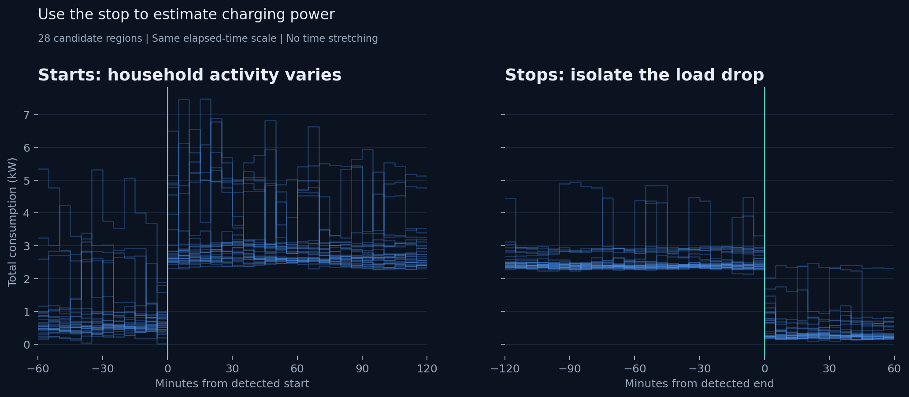
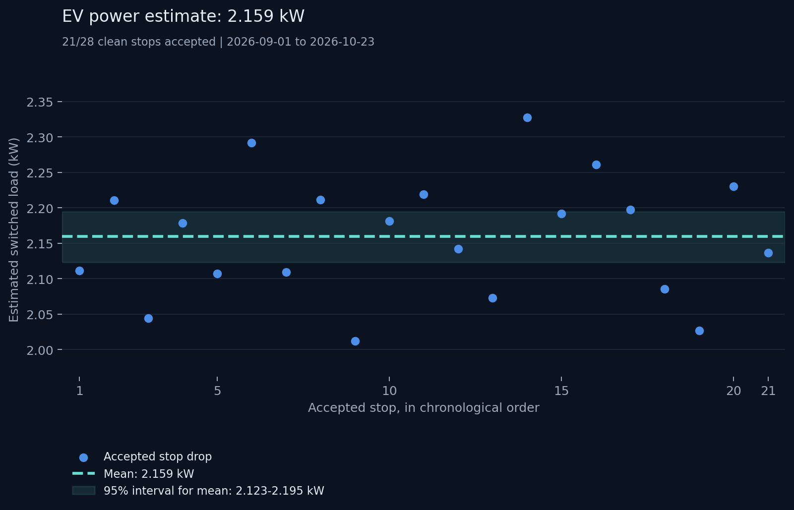

# EV charging power estimate

We estimate EV charging power at **2.159 kW**, using **21 accepted charging stops**. The 25 October 2026 recalibration extends the investigation through 23 October. This replaces 2.169 kW from 17 stops: a reduction of **10 W (0.46%)**. The evidence supports approximately **2.16 kW**; three decimal places keep calculations reproducible rather than implying accuracy to one watt.

## Data

We used FusionSolar's total consumption (`usePower`) from **1 September–23 October 2026**: 53 days of five-minute readings, with no missing target or required context readings. Complete adjacent days, **31 August and 24 October**, supply context, including the end of a session starting on 23 October. Dates use Europe/Brussels; durations are calculated in UTC. We treat power readings as kW, although the source does not confirm their unit.

The local PostgreSQL database was unavailable during recalibration. We reused the previous investigation's validated source export through 10 October and fetched complete snapshots for 11–24 October directly from FusionSolar on 25 October. We validated every source day and daily total before analysis. The earlier 18 candidate drops and acceptance decisions reproduce exactly. No database snapshots were changed.

To find stops for calibration, we select regions with consumption **>2.13 kW for ≥120 minutes**. This fixed candidate threshold is independent of the fitted power. Interruptions and missing readings split regions. Two hours before and after the requested range are required; full adjacent days let us analyse complete sessions crossing midnight.

## How we estimate the power

We use stops because household activity makes charging starts less clear.



*Each line is one candidate region, aligned at its start or stop. Both views show 120 minutes of charging and 60 minutes of surrounding consumption, without stretching time. The clearer stop drop is what we use to estimate EV power.*

Take **t=0** as the first interval below the threshold:

```text
before = mean(P at −15 and −10 minutes)
after  = mean(P at  +5 and +10 minutes)
drop   = before - after
EV power = mean(accepted drops), rounded to 0.001 kW
```

We skip the readings at −5 and 0 minutes because they may contain part of the charging stop. Assuming household consumption stays the same across the two clean windows, the difference estimates the load that switched off.

We keep stops with complete windows, where the region does not touch a gap or the edge of the available data. The drop must be positive, each window's highest and lowest readings must differ by **≤0.2 kW**, and the drop must not exceed the 10th percentile of total consumption in the region. Every accepted stop gets equal weight. We retained the existing method and acceptance rules.

**21/28 candidate stops passed**, including **4/10 additional candidates**:

| Additional accepted stop (Brussels) | Drop |
| --- | --- |
| 13 October 05:50 | 2.0855 kW |
| 15 October 06:55 | 2.0265 kW |
| 18 October 01:25 | 2.2305 kW |
| 22 October 06:55 | 2.1365 kW |

The 12 October stop had an unstable after-window. Drops on 16, 17 and 20 October exceeded their regions' 10th percentiles; these large end drops cannot represent a constant load throughout the region. The 23 October stop failed both checks, and the 24 October stop had an unstable before-window and an excessive drop. The previously excluded 4 October stop still has a negative drop. Rejected calibration stops remain eligible for daily charging detection: rejection concerns power estimation, not whether the entire region contains EV charging.



*Each dot is the power drop at an accepted stop. The dashed line is their mean: 2.159 kW. The shaded band shows the 95% bootstrap interval for that mean, rather than variation between individual stops.*

## Results and stability

| Check | Result |
| --- | --- |
| Mean of 21 accepted stops | **2.159 kW** (unrounded: 2.1594762 kW) |
| 95% bootstrap interval for the mean | **2.1233–2.1947 kW** |
| Standard deviation between accepted stops | 0.0858 kW |
| Four additional accepted stops alone | 2.1198 kW; 95% interval 2.0540–2.1943 kW |
| Nighttime stops only (20 stops, midnight–08:00) | 2.1569 kW |
| Leave one accepted stop out | Means 2.1511–2.1669 kW |
| Window widths 10/15/20 minutes; one/two guarded samples | Means 2.1344–2.1608 kW; 17–21 accepted stops |
| Window spread limits 0.1/0.2/0.3 kW | Means 2.1529–2.1595 kW; 20–22 accepted stops |
| Candidate thresholds 2.0/2.1/2.13/2.159/2.2 kW | Means 2.1595–2.1600 kW; 21–22 accepted stops |

For bootstrap intervals, we resample whole accepted stops 5,000 times and recalculate the unrounded mean, using seed 20261011. The mean's interval is about **8% narrower** than the previous 2.1291–2.2070 kW interval. The four new accepted stops average lower, but their interval includes the previous estimate; this small sample does not establish a change in charger power. Longer windows also move the estimate more than the 10 W recalibration, so window choice and household activity remain material sources of uncertainty.

## Using the estimate

The daily API accepts dates at least two days ago in Europe/Brussels, so both adjacent context days have finished. It stores complete source days once and reuses them; incomplete consumption, daily totals, or required context return an error instead of a provisional estimate.

Daily detection requires consumption **>2.159 kW for ≥120 continuous minutes** and draws an EV block at **2.159 kW**. We subtract no baseload. Each reading covers the following five-minute interval, so energy is `2.159 × charging hours`, counting only the part inside the local day. Across the 53 target days, this gives **28 regions, 236.750 hours and 511.143 kWh**. The previous 2.169 kW model gives 513.330 kWh over the same dates; recalibration reduces the estimate by **2.187 kWh (0.43%)**, including the small change in the detection threshold. All **53 daily analyses and 15,264 interval EV powers** match the investigation when run with the daily API's three-day context.

The shared [EV detector](../src/home_energy/usage/ev.py) sets `EV_POWER_KW = Decimal("2.159")` and model version `clean-stops-2026-10-23-mean-v3`. Both detection and energy use this constant. Redeploy the application to apply it to n8n reports; the workflow gets the value from the API. Re-running a report recalculates EV estimates using unchanged source snapshots.

The interval assumes independent stops that belong to the EV. Other appliances stopping, or household consumption changing at the same time, can affect the estimate. We have not confirmed whether source readings are instantaneous or averaged. The two-hour rule misses shorter sessions, and clean-stop selection may exclude sessions with different power. Charger logs are needed to check attribution and actual charging energy.

## Reproduce and inspect

With PostgreSQL available and provider credentials configured, run:

```powershell
uv run --locked home-energy investigate ev 2026-09-01 --end-date 2026-10-23 --fetch --output outputs/ev-investigation-2026-09-01_2026-10-23
```

Omit `--fetch` when all source and adjacent days are stored. This recalibration's local [HTML report](../outputs/ev-investigation-2026-09-01_2026-10-23/index.html) includes daily graphs, tables and a PDF. Its `source/` directory preserves the complete source export and additional raw payloads; `daily_model_verification.csv` records the daily comparison. Local investigation outputs are gitignored.

The versioned [calibration summary](data/ev-calibration-2026-10-23.json) preserves settings, sensitivity results, source-file SHA-256 hashes and verification counts. The [individual stop measurements](data/ev-ending-estimates-2026-10-23.csv) preserve exact window timestamps, acceptance and rejection reasons. The [report code](../src/home_energy/investigations/ev/report.py) draws the graphs from the measurements calculated by the [calibration code](../src/home_energy/investigations/ev/calibration.py).
